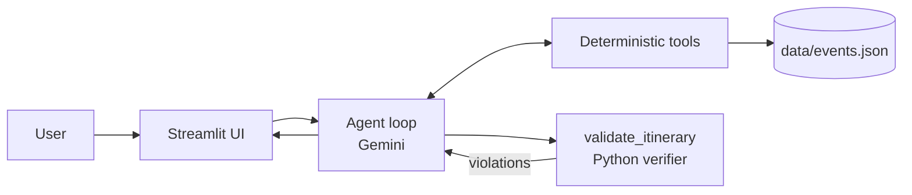

# FUF Agent: Festival, Uncomplicated

**A friendly, agentic day planner that turns Chennai events into a realistic itinerary.** Meet Eggy, your cheerful guide, who helps balance interests, time, travel, budget, and eligibility.

## Problem

- Event information is scattered across posters, calendars, social posts, and venue pages.
- Trip planners plan places, not time-bound events.
- Event apps list events but generally do not schedule a complete day.
- LLM-only plans can sound persuasive while breaking real constraints such as clashes, travel gaps, budgets, eligibility, capacity, and registration status.

## What makes FUF Agent agentic

- **Gemini tool calling:** the model can call `search_events`, `travel_time`, and `check_eligibility`.
- **Verify-and-repair loop:** Python always runs `validate_itinerary`, feeds violations back to the planner, and asks for repairs.
- **Replanning:** changes edit the existing plan instead of blindly starting from scratch.
- **Visible agent trace:** the UI shows model steps, tool arguments, result summaries, and validator verdicts.
- **Greedy fallback:** if Gemini is unavailable or the loop cannot finish, deterministic Python scheduling keeps the demo usable.

## Architecture



## Design note

FUF Agent follows the **LLM-Modulo** idea: use an LLM as a planner and explainer, while an external verifier remains the source of truth for hard constraints. The model chooses and explains; Python validates.

## Demo dataset

The demo contains **60 sample events** across Chennai areas including Guindy, T Nagar, Mylapore, Adyar, Anna Nagar, OMR, and Besant Nagar, all for **Saturday, 24 October 2026**. It intentionally includes overlaps, closed registrations, eligibility restrictions, and sold-out events so the validator has meaningful work to do.

## Setup on Windows

From PowerShell:

```powershell
python -m venv winenv
.\winenv\Scripts\Activate.ps1
pip install -r requirements.txt
```

Create a `.env` file in the project root:

```dotenv
GEMINI_API_KEY=your-api-key
GEMINI_MODEL=gemini-flash-lite-latest
```

Alternatively, add the key to `.streamlit/secrets.toml`:

```toml
GEMINI_API_KEY = "your-api-key"
```

Start the app:

```powershell
streamlit run app.py
```

The app prefers `st.secrets["GEMINI_API_KEY"]` when present and otherwise loads `.env`.

## Screenshots

> Add screenshots of the Eggy welcome state, a completed itinerary with trace, and a replan showing dropped/added events here.


## Future work

- Live event sources and registration links
- More cities and neighborhoods
- Maps and route-aware travel estimates
- FUF campus integration

## Built with

**Built with OmniRush for the Omnirush Agentic Buildathon 2026**
